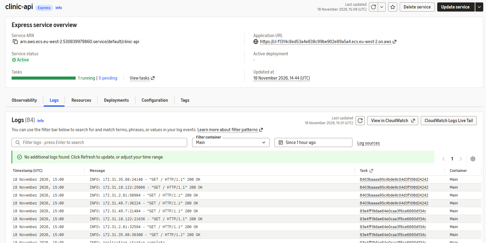
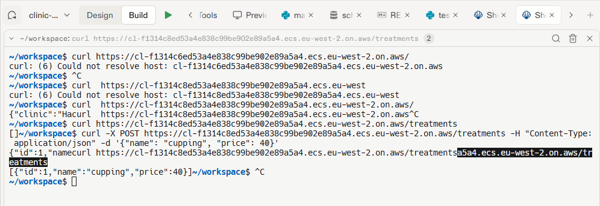

# clinic-api

This API is for Hainault Health clinic where the API talks to my server by sending a request to an address, get data back. the clinic api lets someone get the treatment list, look up one treatment, add a new one or or delete one.  

📄 [Read the case study: how I built and deployed this](CASE_STUDY.md)

## How to run it

```
pip install -r requirements.txt
uvicorn main:app --host 0.0.0.0 --port 8000 --reload
```

## Database
Clinic-api uses a Postgres database. The old in-memory list has been removed.

The app finds the database through the environment variable `DATABASE_URL` (`os.environ["DATABASE_URL"]`), so set it before running the app. 

To create the table on a new machine, run `schema.sql` against the database:

```
psql "$DATABASE_URL" -f schema.sql
```

The tests use the real database, so `DATABASE_URL` must be set. The create and delete tests delete the rows they make, so they don't leave junk behind. 

## Run the tests

```
pytest
```

Expected: 7 passed

What the tests cover:
- GET /treatments returns 200 (list works)
- GET /treatments/99 returns 404 (treatment doesn't exist)
- GET /treatments/abc returns 422 (id isn't a number)
- POST /treatments with a name and price returns 200, and the response contains the name it sent (cupping)
- POST /treatments with a name only returns 422, wrong input as price is missing
- DELETE on a treatment the test just created returns 200; a second DELETE returns 404. 
- GET /treatments/99 returns a 404, and the app logs a warning, which the test checks with caplog.

## Endpoints 

| Method | Path | What it does |
|--------|------|--------------|
| GET | / | Health check. Returns the clinic name and status |
| GET | /treatments | Returns all treatments |
| GET | /treatments/{id} | Returns one treatment by ID. 404 if not found, 422 if the ID isn't a number |
| POST | /treatments | Adds a new treatment. Needs name and price, 422 if either is missing. | 
| DELETE | /treatments/{id} | Removes a treatment by ID. 404 if not found |

## Continuous integration (CI)

Every push to GitHub runs two jobs automatically (`.github/workflows/docker.yml`):

- **build** runs onnly if **test** passes. It logs into AWS with GitHub OIDC (no stored keys), builds the Docker image and pushes it to a private Amazon ECR repository, tagged with the commit ID. 
- **test** starts a temporary Postgres database, creates the table with `schema.sql`, and runs `pytest`. The database is thrown away afterwards, so no real data is ever touched.

See the results in the **Actions** tab on GitHub: a green tick means both jobs passed. 

## Deployment (AWS)

clinic-api has been deployed live on AWS and tested over HTTPS. 

### Architecture 

```
Internet --HTTPS ---> Load balancer --port 8000 ---> Container (ECS Fargate) --port 5432 --> Postgres (RDS)
```

- **GitHub Actions** runs the tests, then builds the Docker image and pushes it to **Amazon ECR**. It logs into AWS with **OIDC**, so no AWS keys are stored in GitHub.
- **ECS Express Mode** runs the container on **Fargate** and creates the load balancer, HTTPS certificate and public URL.
- **RDS Postgres** is **not publicly accessible**. Security groups only let the load balancer reach the app, and only the app reach the database.
- On startup the app creates the table with `schema.sql` (`CREATE TABLE IF NOT EXISTS`, so it is safe to run every time).
- `DATABASE_URL` is passed in as an environment variable, never stored in the code or the image.

### Proof

The service running, with load balancer health checks passing:



Live test: list (empty), create, then read back from the cloud database:



### What went wrong and how I fixed it

The first containers stopped on startup. The logs showed `ConnectionTimeout` when the app tried to reach the database. A timeout (no answer) rather than a password error pointed to the network: the database's security group didn't allow the app. I added an inbound rule for the PostgreSQL (5432) from the app's security group only, and the service went healthy. 

### Cost

The service was torn down after testing to save credits (a load balancer and database cost money every hour, even with no traffic). It can be redeployed from the image in ECR. 

## Example

```
curl localhost:8000/treatments 
[{"id":1,"name":"deep tissue","price":50},{"id":2,"name":"massage","price":45},{"id":3,"name":"sports recovery","price":65}]
```

## What I'm building next

- Deploy to AWS from GitHub Actions (OIDG, no stored keys)
- Deploy it online

## Logging

When a treatment is created, the app logs: an INFO line with its name for example "Creating treatment: cupping". 
When a treatment isn't found (GET or DELETE), the app logs a WARNING with the id, for example "Treatment not found: 99"
These lines can be seen on the server console where the uvicorn is running.

 